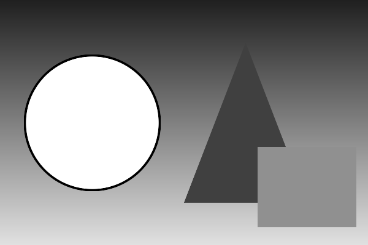

# Pix2Txt

A small C program that converts an image into ASCII art in the terminal.

Each pixel block is mapped to a character based on its brightness, and a Sobel
edge detector then overlays the outlines with `| / _ \` characters that follow
the direction of each edge.

## Sample

Input ([`samples/shapes.png`](samples/shapes.png)):



Output of `./pix2txt.bin samples/shapes.png 80`:

```text
................................................................................
................................................................................
--------------------------------------------------------------------------------
--------------------------------------------------------------------------------
--------------------------------------------------------------------------------
================___________=============================--======================
============___________________=========================---=====================
==========__/_______@@@_______\__======================----=====================
========_//__/@@@@@@@@@@@@@@@\__\\_===================------====================
+++++++///_@@@@@@@@@@@@@@@@@@@@@_\\\+++++++++++++++++=-------=++++++++++++++++++
++++++|//@@@@@@@@@@@@@@@@@@@@@@@@@\\|+++++++++++++++=---------++++++++++++++++++
++++++//@@@@@@@@@@@@@@@@@@@@@@@@@@@\\++++++++++++++=----------=+++++++++++++++++
*****|||@@@@@@@@@@@@@@@@@@@@@@@@@@@|||************/------------\****************
*****||@@@@@@@@@@@@@@@@@@@@@@@@@@@@@||***********/--------------\***************
*****+\|@@@@@@@@@@@@@@@@@@@@@@@@@@@|/+**********//---------------|**************
xxxxxx|\@@@@@@@@@@@@@@@@@@@@@@@@@@@/|xxxxxxxxxx/|-----------_____/*xxxxxxxxxxxxx
xxxxxx*\\\@@@@@@@@@@@@@@@@@@@@@@@///*xxxxxxxxx/|-----------|/_____xxxxxxxxxxxxxx
xxxxxxxx\\_@@@@@@@@@@@@@@@@@@@@@_//xxxxxxxxxxx|/-----------||xxxxxxxxxxxxxxxxxxx
#########*____@@@@@@@@@@@@@@@____*###########/|------------||xxxxxxxxxxxxxxxxxxx
###########x___________________x############//-------------||xxxxxxxxxxxxxxxxxxx
###############*___________*###############|/--------------||xxxxxxxxxxxxxxxxxxx
$$$$$$$$$$$$$$$$$$$$$$$$$$$$$$$$$$$$$$$$$$$|________________/xxxxxxxxxxxxxxxxxxx
$$$$$$$$$$$$$$$$$$$$$$$$$$$$$$$$$$$$$$$$$$$_________________xxxxxxxxxxxxxxxxxxxx
$$$$$$$$$$$$$$$$$$$$$$$$$$$$$$$$$$$$$$$$$$$$$$$$$$$$$$$$$$$$xxxxxxxxxxxxxxxxxxxx
$$$$$$$$$$$$$$$$$$$$$$$$$$$$$$$$$$$$$$$$$$$$$$$$$$$$$$$$$$$$___________________x
&&&&&&&&&&&&&&&&&&&&&&&&&&&&&&&&&&&&&&&&&&&&&&&&&&&&&&&&&&&&&&&&&&&&&&&&&&&&&&&&
```

## Building

Requires `gcc` and `make`. Image loading is handled by the bundled
[stb_image](https://github.com/nothings/stb) header, so there are no other
dependencies.

```sh
make        # builds pix2txt.bin
make clean  # removes build artifacts
```

## Usage

```sh
./pix2txt.bin <input_image> <output_width>
```

- `input_image`: any format stb_image supports (JPEG, PNG, BMP, TGA, GIF, PSD, HDR, PNM, ...)
- `output_width`: width of the output in characters. The height is derived
  from the image's aspect ratio, halved to compensate for terminal characters
  being roughly twice as tall as they are wide.

## How it works

1. **Load:** the image is loaded as single-channel grayscale (`main.c`).
2. **Scale:** pixels are averaged over blocks to shrink the image to the output size
   (`scale_image/scale_image.h`).
3. **Shade:** each pixel's brightness is mapped onto the ramp `" .-=+*x#$&X@"`, dark to bright
   (`convert_to_ascii.h`).
4. **Edges:** a 3x3 Sobel filter finds edges, which are drawn as `|`, `_`, `/` or `\`
   depending on the gradient direction (`add_edges/add_edges.h`).

## Project structure

```
.
├── main.c                    # entry point: argument parsing, pipeline, output
├── convert_to_ascii.h        # brightness → character mapping
├── scale_image/scale_image.h # block-average downscaling
├── add_edges/add_edges.h     # Sobel edge detection overlay
├── stb_image.h               # third-party image loader (public domain)
├── samples/                  # sample input images
└── makefile
```
